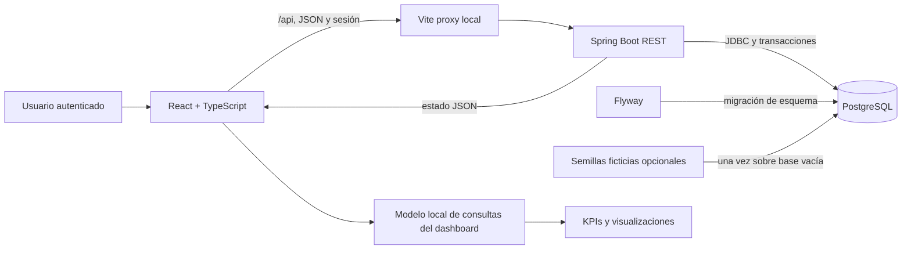
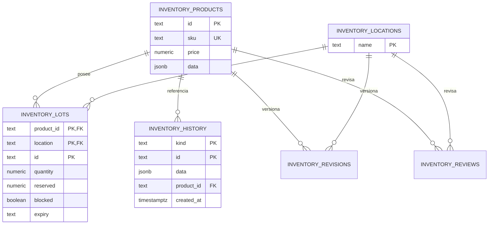

# Informe del Proyecto 3: Sistema de inventario con dashboard

> **Borrador académico basado en el código del repositorio.** Completar los campos entre corchetes y adjuntar capturas, resultados de ejecución y datos del equipo antes de entregar. Este informe distingue las funciones implementadas de las mejoras recomendadas; no afirma que el escenario de prueba sea información real de Farmacorp.

## Datos de presentación

- **Institución:** [nombre de la institución]
- **Carrera / asignatura:** [carrera y asignatura]
- **Docente:** [nombre]
- **Integrantes:** [nombres completos]
- **Proyecto:** Sistema de inventario con dashboard para análisis operativo
- **Fecha de entrega:** [fecha]
- **Repositorio / versión evaluada:** [URL o identificador de commit]

## Resumen ejecutivo

El proyecto implementa una aplicación web de inventario con un dashboard de operación. La interfaz está desarrollada con React, TypeScript y Vite; el backend utiliza Java 21 y Spring Boot; PostgreSQL conserva productos, ubicaciones, lotes, operaciones, cuentas y auditoría. La aplicación consulta los datos mediante una API REST. El dashboard recibe una instantánea consistente de la API y calcula en el navegador indicadores de stock, reorden, vencimientos y conteos.

La solución sirve para demostrar flujos de inventario persistentes y decisiones operativas. El escenario precargado es ficticio y local. El sistema no consume un almacén corporativo ni una fuente real de datos de Farmacorp. La base relacional es principalmente transaccional; no implementa un data warehouse ni un esquema estrella. Además, el historial y parte del maestro de productos usan JSONB. Por ello, las fórmulas del tablero se pueden explicar y reproducir, pero no corresponde presentar los resultados de la demo como mediciones reales de la empresa ni afirmar que se originan en un modelo analítico limpio.

La evaluación del proyecto debe separar tres aspectos: que los datos se persistan de forma real en PostgreSQL; que los indicadores apliquen reglas definidas; y que la validez de negocio depende de datos de origen representativos y verificados. Este informe explica los tres aspectos y propone mejoras concretas para acercarse a los niveles superiores de la rúbrica.

## 1. Problema, objetivo y alcance

### 1.1 Problema

La operación de inventario necesita conocer cuánto producto puede utilizarse o venderse, qué productos requieren reposición, qué lotes se acercan a su vencimiento y qué conteos físicos presentan diferencias. Si estas señales se consultan por separado, el usuario debe reunir información de productos, ubicaciones, lotes, ventas y conteos antes de decidir qué acción tomar.

### 1.2 Objetivo general

Desarrollar un sistema web de inventario que registre operaciones de forma persistente y presente indicadores operativos con contexto por sucursal y período, para ayudar al usuario a priorizar reposiciones, revisar vencimientos y atender diferencias de inventario.

### 1.3 Objetivos específicos

1. Mantener un catálogo de productos y ubicaciones, junto con lotes, saldos y reservas.
2. Registrar recepciones, ventas POS simuladas, transferencias y conteos con trazabilidad de operación.
3. Aplicar reglas de autorización en el servidor según el perfil autenticado.
4. Mostrar indicadores de inventario y ofrecer navegación desde las señales hacia las pantallas operativas.
5. Persistir las operaciones y conservarlas al reiniciar los servicios locales.

### 1.4 Alcance y límites

El alcance implementado es una demo académica local. Incluye datos semilla ficticios, cuentas de desarrollo y persistencia PostgreSQL. No incluye integración con el POS real, ERP corporativo, compras reales, datos maestros oficiales, analítica histórica de snapshots, despliegue productivo ni un proceso ETL hacia un data warehouse. Las ubicaciones y el escenario inicial no se deben interpretar como información oficial de Farmacorp.

## 2. Arquitectura de la solución

### 2.1 Componentes

| Componente | Tecnología | Responsabilidad |
|---|---|---|
| Interfaz | React, TypeScript, Vite | Formularios, navegación, filtros, visualización y cálculo local de las consultas del dashboard. |
| API | Java 21, Spring Boot 3.5.7, JDBC | Autenticación, autorización, validación de comandos, reglas de inventario, lecturas y escrituras. |
| Base de datos | PostgreSQL 17 | Persistencia de maestros, lotes, saldos, historial, configuración, usuarios y auditoría. |
| Migraciones | Flyway | Creación versionada del esquema mediante la migración SQL inicial. |
| Ejecución local | Docker Compose | Inicio de PostgreSQL y backend; Vite se ejecuta con npm en el equipo de desarrollo. |

### 2.2 Vista de arquitectura



El frontend llama a `/api/state` para cargar la instantánea y envía mutaciones a los endpoints de API. Vite reenvía `/api` al backend local. El servicio de inventario realiza las consultas SQL, convierte el resultado en una respuesta JSON y, para las escrituras, aplica validaciones y reglas de negocio dentro de transacciones. El servicio protege las mutaciones con un bloqueo asesor transaccional global, una decisión sencilla para evitar escrituras concurrentes incompatibles en esta demo local; serializa escritores y no se presenta como una solución de alto rendimiento para cargas empresariales.

La sesión se mantiene en el servidor. La contraseña se valida con BCrypt; las operaciones requieren autenticación y las mutaciones requieren token CSRF. Los permisos se comprueban en el backend según el rol de sesión, no según un rol enviado en el cuerpo de la petición.

### 2.3 Flujo de una consulta al dashboard

1. El usuario inicia sesión y la aplicación solicita `GET /api/state`.
2. El backend obtiene ubicaciones, configuración, productos, lotes e historiales de la base de datos.
3. El backend ejecuta la lectura en una transacción `REPEATABLE_READ`, para que las partes de la instantánea correspondan a una lectura consistente.
4. El frontend guarda temporalmente esa respuesta en el estado de React.
5. `queryDashboard` recibe el estado, la sucursal, el período, el día de negocio y la anticipación elegida.
6. El navegador calcula stock elegible, consumo, estado de reorden, lotes por vencer y el último conteo incluido en el período.
7. La interfaz presenta los resultados y permite navegar hacia existencias, reposición, vencimientos o conteos.

No existe una tabla de KPIs ni una consulta SQL que devuelva estas métricas ya agregadas. El cálculo se hace en el cliente a partir de la instantánea del backend. El botón **Actualizar datos** vuelve a consultar la API; el cambio de día de negocio no sustituye por sí solo la carga de datos.

## 3. Arquitectura de datos y modelo

### 3.1 Tablas principales

| Tabla | Datos relevantes | Uso en el sistema / dashboard |
|---|---|---|
| `inventory_products` | `id`, `sku`, `price` y `data` JSONB | Maestro de productos. `threshold` (ROP), nombre, unidad, categoría y otros atributos viajan dentro de `data`. El precio también se conserva como columna decimal. |
| `inventory_locations` | Nombre de ubicación | Catálogo de ubicaciones y opciones de sucursal. |
| `inventory_lots` | Producto, ubicación, lote, cantidad, reservado, bloqueo, vencimiento | Fuente de stock disponible, composición por lote y vencimientos. Clave primaria compuesta por producto, ubicación y lote; producto y ubicación son claves foráneas. |
| `inventory_history` | `kind`, `id`, `data` JSONB, `product_id` generado, `created_at` | Historial de movimientos, transferencias, conteos y ventas. `kind` identifica el tipo; los campos específicos de cada operación están en `data`. El `product_id` generado permite una referencia foránea al producto. |
| `inventory_revisions` | Producto, ubicación, revisión | Versión del saldo por producto y ubicación. Ayuda a detectar si el inventario cambió desde el registro de un conteo. No alimenta directamente un KPI del dashboard. |
| `inventory_reviews` | Producto, ubicación, fecha, actor | Registro de revisión de reposición. No es la fuente del KPI “próximos a reorden”. |
| `inventory_settings` | `alert_days` | Parámetro de alertas del módulo. No determina la ventana fija de 90 días del KPI de vencimientos del dashboard. |
| `app_users` | Usuario, hash de contraseña, rol | Autenticación y autorización. |
| `inventory_audit` | Actor, operación, fecha y payload | Registro de auditoría de operaciones. |
| `inventory_seed_marker` | Marcador único | Evita repetir la semilla del escenario. |

El modelo central de saldos es relacional: producto → lotes por ubicación; las entidades de inventario referencian productos y ubicaciones mediante claves foráneas. Los índices únicos de SKU y ubicación ignoran diferencias entre mayúsculas y minúsculas. El esquema está definido en `backend/src/main/resources/db/migration/V1__inventory.sql`.

### 3.2 Modelo lógico resumido



### 3.3 Evaluación honesta del modelo

El esquema es funcional para persistencia transaccional de esta aplicación, pero no es un modelo analítico limpio ni un esquema estrella. No hay una tabla de hechos de ventas separada, dimensiones de producto, ubicación y fecha, ni procesos ETL que limpien e integren una fuente externa. Las ventas y conteos se leen como documentos JSONB desde `inventory_history`.

La flexibilidad de JSONB evita crear muchas tablas históricas, pero reduce la validación estructural de los campos de cada evento y vuelve más difíciles las consultas analíticas, la evolución de esquemas y los índices por atributos internos. En productos, `price` y `sku` están en columnas, mientras otros atributos están dentro de `data`; esto es una mezcla de columnas tipadas y documento flexible. En lotes, `expiry` es texto y `quantity`/`reserved` son `numeric` sin escala explícita; para una fecha y unidades enteras, podrían emplearse tipos SQL más restrictivos si esos son los requisitos confirmados.

Por tanto, la formulación precisa para el informe es: **“La aplicación integra una API con una base PostgreSQL operacional y calcula indicadores sobre una instantánea consistente; el proyecto no implementa todavía un repositorio analítico ni una integración con datos corporativos reales.”** No afirmar “datos integrados desde un modelo analítico limpio” en la versión actual.

### 3.4 Origen, validación y calidad de datos

El entorno local puede cargar una semilla de desarrollo cuando `SEED_DATA=true`, y usuarios de desarrollo cuando `SEED_USERS=true`. El escenario base se inserta una sola vez sobre una base sin productos ni ubicaciones; si el marcador del escenario ya existe, el seed puede completar de forma idempotente los conteos de demostración que falten, sin reemplazar operaciones existentes. Todos los conteos de seed son ficticios. Flyway aplica la migración al iniciar el backend. Los datos introducidos por formularios se validan en el backend y luego se guardan en PostgreSQL.

Entre los controles existentes están: SKU único sin distinción de mayúsculas; precios, umbrales y reposición no negativos; cantidades no negativas; reserva entre cero y cantidad total; referencia de producto/ubicación en saldos; y validación de permisos en servidor. Las ventas simuladas se almacenan como atendidas o rechazadas. Los formularios no reemplazan una política corporativa de calidad de datos: antes de conectar fuentes reales se deben definir responsables, formatos, reglas de duplicados, unidades, zonas horarias, vigencia de productos y conciliación contra un sistema oficial.

## 4. Definición y fuente de los indicadores

El dashboard trabaja con una sucursal seleccionada. De forma inicial intenta seleccionar **Sucursal Equipetrol**. El período inicial cubre 30 días calendario, incluidos el día de inicio y el de fin. Las fechas de negocio se interpretan con la zona `America/La_Paz`. El período afecta ventas y conteos; stock, ROP y vencimientos representan el estado actual de la sucursal.

| Indicador | Fuente y fórmula implementada | Lectura y límite |
|---|---|---|
| Stock disponible | Para producto y sucursal, suma `quantity − reserved` de lotes no bloqueados, no vencidos al día actual y con `quantity > reserved`. | Mide unidades elegibles según las reglas locales. Lotes sin vencimiento pasan la condición de fecha. No es una fotografía histórica del período seleccionado. |
| ROP | Lee `threshold` del maestro del producto en `inventory_products.data`. | Es un umbral configurado manualmente. El dashboard no lo calcula con lead time ni stock de seguridad. |
| Productos para reordenar | Cuenta productos con `stock disponible ≤ ROP`. | Se cuenta producto por sucursal, no lote. La igualdad también activa reorden. |
| Consumo diario promedio | `suma de quantity de ventas fulfilled en la sucursal y el período ÷ número de días calendario inclusivos`. | Excluye ventas rechazadas y ventas de otras ubicaciones o fechas. Si no hay ventas, la proyección queda sin datos. |
| Próximos a reorden | Si el stock ya es menor o igual al ROP, el producto es “reordenar”. Si no, calcula `días hasta ROP = (stock − ROP) ÷ consumo diario`. Clasifica “próximo” cuando los días estimados son `≤ anticipación`; por defecto, 7 días. | Es una proyección lineal simple sobre consumo promedio del período; no incorpora variabilidad, lead time, estacionalidad, pedidos abiertos ni stock de seguridad. La anticipación del usuario se limita a 1–365 días. |
| Lotes próximos a vencer | Cuenta lotes de la sucursal desbloqueados, con fecha válida en el intervalo `(hoy, hoy + 90 días]` y unidades disponibles (`quantity > reserved`). | Cuenta lotes, no productos ni unidades. No depende del período de fechas seleccionado; usa el estado actual y la ventana fija de 90 días. |
| Exactitud del último conteo | Filtra conteos aprobados de la sucursal cuya fecha de aprobación cae dentro del período. Ordena de más reciente a más antiguo. Sobre el primer registro: `100 %` si `system = physical`, `0 %` si son distintos. | Es un solo conteo de un producto, marcado parcial. No es promedio, tasa de exactitud global ni precisión porcentual proporcional a la diferencia. Si el último conteo global queda fuera del rango, puede mostrarse el último conteo dentro del filtro. La semilla de demo conserva uno exacto reciente en Equipetrol, uno con diferencia en Cala Cala y uno de hace 45 días en CEDIS Central; para ver este último, ampliar el filtro a 60 días. |

La fórmula teórica convencional de ROP mostrada en la interfaz es `(consumo diario × lead time) + stock de seguridad`, pero el código conserva el `threshold` existente porque el maestro no tiene lead time ni stock de seguridad. El número que aparece como ROP procede del valor configurado, no de aquella fórmula.

La exactitud del conteo merece una explicación especial en la exposición: si el sistema esperaba 10 unidades y el conteo físico registra 9, el indicador presenta 0 % para ese registro, no 90 %. El tablero utiliza igualdad total/no igualdad para que el resultado sea comprensible como “sin diferencia” o “con diferencia”, pero esa medida no debe describirse como exactitud porcentual clásica de inventario. Una medición más informativa requeriría varios productos o líneas de conteo y una fórmula definida, por ejemplo, proporción de líneas sin diferencia sobre líneas aprobadas; además, un conteo de cobertura completa debería poder identificarse como una sesión agrupada.

## 5. Diseño UX/UI y carga cognitiva

La pantalla Resumen muestra primero tres indicadores operativos: productos para reordenar, próximos a reorden y lotes próximos a vencer. Después presenta el gráfico de stock disponible frente al ROP configurado, el bloque de conteos y las acciones recomendadas. La versión actual usa azul oscuro como color principal (`#1f427a`); los colores de estado distinguen alertas. Cada cifra se acompaña de una etiqueta. La meta académica de exactitud se muestra junto al resultado; el gráfico compara explícitamente stock con ROP.

La interfaz prioriza la operación: una fila conduce a reposición, un lote abre el detalle de vencimientos, el producto permite ir a existencias y los conteos llevan al módulo de control. Hay filtros de sucursal, período, región y departamento; la anticipación para reorden puede modificarse en el contexto del cálculo. El formulario de filtros valida fechas y dependencias antes de aplicarse. El diálogo de vencimientos tiene navegación por teclado y posibilidad de cierre con Escape; los controles principales tienen etiquetas accesibles.

La clasificación geográfica de las sucursales incluidas está escrita en el frontend. En particular, CEDIS Central se asigna a La Paz/Altiplano como supuesto de la demo, y ubicaciones no reconocidas quedan como “Sin clasificar”. La selección de región/departamento limita las sucursales disponibles, pero no consolida automáticamente los KPIs de todas las ubicaciones de una región.

**Evidencia visual disponible en el repositorio:** [vista del dashboard](evidencia-rendimiento/dashboard.jpg) y [filtros globales abiertos](evidencia-rendimiento/filtros.jpg). La vista actual muestra el escenario simulado de 10 productos, 9 productos para reordenar, 2 lotes próximos a vencer y un conteo aprobado con 100 % de exactitud (1 de 1 registros sin diferencia; fecha visible: 2 nov 2026). Para la exposición completa todavía conviene añadir capturas del selector de sucursal y del detalle de vencimientos, si esos estados se van a presentar.

## 6. Data storytelling e insights accionables

El tablero sigue una secuencia operativa que puede exponerse como **What? → So what? → Now what?**:

1. **What? (qué ocurre):** indica cuántos productos llegaron al punto de reorden, cuáles se acercan según su consumo reciente, cuántos lotes vencen dentro de 90 días y cuál fue el resultado del último conteo incluido en el período.
2. **So what? (por qué importa):** compara stock elegible con el ROP y usa una meta visible para exactitud. Las señales ordenan productos según estado y días estimados hasta reorden, de forma que la persona entienda la urgencia.
3. **Now what? (qué hacer):** desde cada señal se puede abrir reposición, existencias, vencimientos o control de inventario. El sistema orienta a revisar y decidir; no genera automáticamente una orden de compra.

El mensaje de decisión que se propone para presentar el tablero es: **“Atender primero los productos por debajo del umbral; luego revisar los que podrían llegar al ROP dentro del horizonte configurado y los lotes con vencimiento próximo; finalmente, investigar el último conteo con diferencia.”** Esta recomendación solo es válida para la sucursal y filtros que se muestran en la pantalla.

## 7. Interacción, filtros y rendimiento

Los filtros se ubican en el encabezado del dashboard y se aplican junto con la sucursal compatible. Cambiar el rango de fechas modifica la selección de ventas usadas para consumo y conteos aprobados considerados. No cambia los saldos actuales, ROP ni la lista de vencimientos. La sucursal seleccionada sí es contexto para todos estos cálculos. La región/departamento filtra qué sucursales pueden seleccionarse, a partir del mapa local del frontend.

Los elementos visuales permiten navegar a los módulos relacionados, pero no todos producen una interacción cruzada que filtre otros gráficos. Por ejemplo, pulsar un KPI lleva a una pantalla operativa; pulsar un producto abre existencias; el gráfico no recalcula las demás cifras usando ese producto como filtro.

El modelo es local y síncrono: recorre arreglos recibidos en la instantánea. La API devuelve todos los productos, lotes e historiales del usuario, y el frontend efectúa agregaciones después de recibirlos. Se registraron cinco interacciones de filtros en Safari sobre la instancia local: desde aplicar/cerrar el panel hasta observar la actualización del dashboard mediante el estado de accesibilidad del navegador. Los cinco tiempos quedaron por debajo de 2 s. Esta medición de extremo a extremo no separa el tiempo de frontend del backend y no es una prueba de carga ni una garantía para producción. Tampoco mide la carga inicial ni el cambio de sucursal de forma aislada.

### Evidencia de medición de rendimiento

| Iteración de filtro | Productos del escenario | Tiempo observado | Navegador | Resultado |
|---|---:|---:|---|---|
| 1 | 10 | 573 ms | Safari local | < 2 s |
| 2 | 10 | 471 ms | Safari local | < 2 s |
| 3 | 10 | 554 ms | Safari local | < 2 s |
| 4 | 10 | 550 ms | Safari local | < 2 s |
| 5 | 10 | 569 ms | Safari local | < 2 s |
| **Promedio** | **10** | **543 ms** | **Safari local** | **< 2 s** |

El registro reproducible y las capturas están en [`evidencia-rendimiento/`](evidencia-rendimiento/). Para completar la evaluación de otros escenarios, medir también carga inicial y cambio de sucursal, e indicar el tamaño de datos usado. No extrapolar esta prueba pequeña a producción.

## 8. Seguridad y controles operativos

El backend aplica autenticación por sesión, almacena contraseñas como hashes BCrypt, limita el origen CORS al entorno local, requiere CSRF para operaciones de escritura y obtiene el rol del usuario autenticado. Los DTO de productos validan campos requeridos y valores no negativos. El servicio también protege reglas como unicidad de SKU, cantidades disponibles, lotes elegibles y aprobación de conteos.

Estas medidas describen controles presentes en el código; no equivalen a una certificación ni a una auditoría de seguridad de producción. El entorno local usa HTTP y configuración de cookie de desarrollo. Para producción harían falta TLS, secretos administrados, política de sesiones, monitoreo, copias de seguridad, gestión de vulnerabilidades y pruebas de seguridad apropiadas.

## 9. Verificación y reproducibilidad

El repositorio incluye pruebas del modelo del dashboard y reglas de dominio en `tests/`, además de pruebas de integración del backend en `backend/src/test/`. El proyecto ofrece estos comandos para producir evidencia actualizada:

```bash
# Requisitos: Docker con Compose, Node compatible y npm
cp .env.example .env
docker compose up --build -d
npm ci
npm test
npm run build

# Pruebas de integración backend con PostgreSQL/Testcontainers
cd backend
./mvnw test
```

Las pruebas backend con Testcontainers necesitan que Docker pueda ejecutarse. Antes de entregar, registrar las salidas reales, fecha, versión del navegador, configuración usada y cualquier prueba que no haya podido ejecutarse. No copiar resultados de documentación previa como si fueran una ejecución de esta versión. Añadir también una demostración manual: inicio de sesión, carga de un KPI, cambio de filtro, persistencia tras reinicio y respuesta ante desconexión del backend.

### Evidencias por adjuntar

- [ ] Salida actual de `npm test`.
- [ ] Salida actual de `npm run build`.
- [ ] Salida actual de `./mvnw test`, si Docker/Testcontainers está disponible.
- [ ] Estado de salud de backend y PostgreSQL.
- [x] Capturas de vista general y filtros en `evidencia-rendimiento/`.
- [ ] Capturas del selector de sucursal y del detalle de vencimientos, si se mostrarán en la exposición.
- [x] Registro de cinco interacciones de filtros y tamaño del escenario probado (`evidencia-rendimiento/README.md`).
- [ ] Medición independiente de carga inicial y cambio de sucursal, si la rúbrica los evalúa por separado.
- [ ] Identificador del commit exacto evaluado.

## 10. Correspondencia con la rúbrica

La rúbrica distribuye 100 puntos entre seis criterios. La tabla siguiente no asigna una nota; resume evidencia del proyecto y brechas que conviene resolver o declarar durante la defensa.

| Criterio | Peso | Evidencia implementada | Brecha / evidencia pendiente |
|---|---:|---|---|
| Arquitectura de Datos y Modelo | 20 % | PostgreSQL con claves, restricciones, Flyway, persistencia y lectura transaccional consistente. | No hay modelo analítico/estrella; historial y atributos de producto usan JSONB; faltan fuente corporativa real y perfilado de datos. Presentar como modelo transaccional de demo. |
| Diseño UX/UI y Carga Cognitiva | 30 % | KPIs en la parte superior, jerarquía de estados, etiquetas, comparación stock/ROP y enlaces a acciones. | Adjuntar capturas de la versión final y verificar visualmente que el orden y las dimensiones cumplen el patrón esperado en el equipo de presentación. |
| Relevancia de KPIs y Contexto | 20 % | Reorden, consumo reciente, vencimientos y conteos se relacionan con inventario; varios tienen comparación o horizonte visible. | Explicar las limitaciones del ROP configurado y de la exactitud binaria de un solo conteo. Evitar llamarlos mediciones empresariales reales. |
| Data Storytelling e Insights Accionables | 10 % | Priorización por estado, acciones operativas y navegación a módulos relacionados. | En la presentación, interpretar una situación concreta con datos visibles y narrar What/So What/Now What, sin inventar hallazgos. |
| Interacción, Filtros y Rendimiento | 10 % | Sucursal, región, departamento, fechas y anticipación; validación de filtros y acciones de navegación. | No hay latencia medida ni prueba de carga aportada aquí. Las interacciones llevan a módulos; no hay filtrado cruzado de todos los gráficos. |
| Presentación del Dashboard (Sistema e informe) | 10 % | Arquitectura, flujo, fórmulas, modelo y comandos de reproducción descritos en este documento. | Completar portada, nombres, fecha, evidencias, resultados actuales, limitaciones y guion de demostración. |

## 11. Mejoras recomendadas

### Prioridad alta para la entrega

1. Usar los datos semilla únicamente como **escenario simulado** y mostrar esa condición en el discurso de defensa.
2. Añadir capturas y resultados de pruebas ejecutadas en la versión final, con fecha y commit.
3. Definir con precisión “exactitud del conteo” y explicar que el KPI actual es binario y parcial.
4. Medir la respuesta de filtros y registrar el volumen de datos usado; no prometer el umbral de 2 segundos sin medición.
5. Completar la portada, el equipo, la asignatura y la fecha.

### Prioridad de evolución técnica

1. Incorporar fuentes oficiales mediante un proceso de carga con validación, registro de errores y conciliación.
2. Diseñar un modelo analítico separado del transaccional, con hechos de ventas/conteos/movimientos y dimensiones de fecha, producto y ubicación cuando la necesidad analítica lo justifique.
3. Tipar atributos consultados con frecuencia en columnas relacionales o vistas/materializaciones; usar tipo `date` para vencimiento y definir precisión/unidad para cantidades.
4. Formalizar la semántica de conteos: agrupar líneas por sesión, registrar cobertura y acordar una fórmula de exactitud que represente el objetivo académico y del negocio.
5. Guardar snapshots o hechos históricos si se necesita analizar stock a fechas pasadas; el saldo actual no reconstruye inventarios históricos.
6. Medir escalabilidad. Si los historiales crecen, paginar o agregar consultas en servidor y reducir el volumen completo transferido al navegador.

## 12. Conclusiones

El proyecto demuestra una arquitectura web de tres componentes con persistencia real, operaciones de inventario y un dashboard que calcula indicadores sobre datos de la aplicación. Las reglas implementadas se pueden rastrear desde las tablas y el backend hasta el modelo de consultas en TypeScript. Los datos iniciales son ficticios, por lo que la validez académica del ejercicio depende de presentar el sistema como una demo y no como una integración productiva de Farmacorp.

Frente a la rúbrica, la principal fortaleza es que los indicadores se conectan con acciones operativas y tienen fórmulas inspeccionables. Las principales brechas son la falta de una capa analítica limpia, la estructura JSONB de parte del historial, la interpretación limitada de la exactitud y la ausencia de una medición reproducible de rendimiento adjunta a este informe. Declarar estas diferencias con claridad permite defender con rigor lo construido y proponer mejoras viables.

## Referencias técnicas del repositorio

- Esquema PostgreSQL: `backend/src/main/resources/db/migration/V1__inventory.sql`.
- Consulta y construcción de la instantánea API: `backend/src/main/java/com/farmacorp/inventory/inventory/InventoryService.java`.
- Endpoint REST del estado: `backend/src/main/java/com/farmacorp/inventory/inventory/InventoryController.java`.
- Fórmulas del dashboard: `src/dashboardModel.ts`.
- Presentación e interacción del dashboard: `src/InventoryDashboard.tsx`.
- Tipos de estado compartido: `src/types.ts`.
- Pruebas del modelo del dashboard: `tests/dashboard.test.mjs`.
- Pruebas de integración del backend: `backend/src/test/java/com/farmacorp/inventory/`.
- Configuración local: `compose.yaml`, `vite.config.ts`, `backend/src/main/resources/application.yml`.
