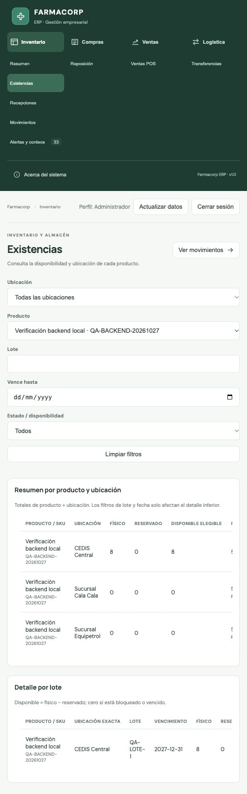

# Verificación del backend local

Fecha: 27 de octubre de 2026, America/La_Paz. Trabajo delegado explícitamente a tres subagentes `gpt-6.1-terra`: inventario/persistencia, frontend y plataforma/seguridad. Integración y revisión por el agente principal. Sin commit, push ni nube.

## Pruebas ejecutadas

- `npm test`: 28 aprobadas, 0 fallidas. Reglas de referencia TypeScript y cálculos del dashboard.
- `npm run build`: aprobado, TypeScript y Vite.
- `cd backend && ./mvnw test`: 10 aprobadas, 0 fallidas, 0 errores, 0 omitidas. PostgreSQL 17.6 real mediante Testcontainers; Flyway crea cada base vacía. Java local 23 compila con release 21; la imagen ejecuta Java 21.
- `git diff --check`: aprobado.

| Suite | Casos | Cobertura |
| --- | ---: | --- |
| InventoryIntegrationTest | 2 | FEFO por varios lotes, ID POS repetido/conflictivo, recepción doble de transferencia, conteo obsoleto, permisos y dos ventas simultáneas sobre 5 unidades: una atiende 4 y la otra queda rechazada, saldo final 1. |
| InventoryRulesIntegrationTest | 5 | Reservas/bloqueos/vencidos, rechazos persistidos aun después de reponer, rollback de recepción cuando falla la segunda asignación, ajuste negativo inelegible sin cambios parciales, aprobación y maestros protegidos. |
| InventorySeedIntegrationTest | 1 | 10 productos/11 lotes/transferencia semilla, conciliación con movimientos y antes/después; ejecuciones repetidas no duplican ni sobrescriben una recepción posterior. |
| SecurityIntegrationTest | 2 | Login real BCrypt/sesión, rotación de ID de sesión, CSRF, logout, 401/403/400 JSON, validación DTO, rol/usuario forjados ignorados y actor de movimiento obtenido de identidad autenticada. |

Docker Desktop 29.7.2 requería compatibilidad de API del cliente Testcontainers; Surefire fija `api.version=1.44`, por lo que el comando documentado no necesita argumentos ocultos. La primera invocación sin Docker y las invocaciones restringidas por sandbox fallaron de forma visible; los resultados anteriores corresponden a la repetición con Docker disponible y acceso efectivo al socket.

## Alcance de las comprobaciones

Los tests ejercitan el servidor y PostgreSQL, no H2 ni un motor de stock en memoria. Los tests TypeScript del motor anterior son referencia de regresión: la interfaz ya no llama sus mutaciones ni carga `localStorage`.

Las lecturas se devuelven como instantánea para mantener las pantallas existentes. El historial usa documentos JSONB con ID único y referencia de producto, junto a tablas de saldos y revisiones. El bloqueo transaccional global es correcto para este alcance local y limita el rendimiento de escritura; no se ha medido capacidad empresarial ni se ha hecho prueba de carga prolongada.

## Recorrido navegador → API → PostgreSQL ejecutado

- `docker compose up --build -d`: imagen Maven/Java 21 construida; PostgreSQL y backend saludables. El paso de compilación usa caché Maven y no descarga todas las extensiones opcionales de Flyway.
- Logs: Flyway aplicó V1 sobre esquema vacío de PostgreSQL 17.6. `/actuator/health` devolvió `{"status":"UP"}`.
- Login mediante navegador como `admin` con la contraseña local del ejemplo. La UI cargó diez productos desde la API.
- Datos maestros: producto `QA-BACKEND-20261027`, nombre “Verificación backend local”, precio 12,50, trazable, punto 5 y sugerencia 10.
- Recepción desde la UI: 8 unidades en CEDIS Central, lote `QA-LOTE-1`, vencimiento `2027-12-31`, referencia `OC-QA-BACKEND-1`.
- Consulta SQL directa: precio `12.5000`, cantidad 8, reservado 0, mismo lote/vencimiento; movimiento con actor `admin · Administrador`, referencia OC y antes 0 / después 8.
- Detener backend y pulsar Actualizar datos mostró error 502 con advertencia explícita de que los datos visibles son la última consulta correcta. No se activaron semillas ni mocks.
- Reiniciar PostgreSQL y arrancar backend de nuevo, esperar ambos healthchecks, recargar navegador y volver a iniciar sesión: producto y lote siguen mostrando 8 unidades. Consulta SQL posterior confirmó 11 productos, un solo marcador de semilla y Flyway V1 exitosa.
- Los servicios quedan ejecutándose localmente; el producto QA se conserva como evidencia en la base de desarrollo. Las pruebas automáticas usan bases aisladas desechables.

## Límites explícitos

El recorrido de navegador comprobó login, creación, recepción, consulta, interrupción de conexión y persistencia tras reinicio. Transferencias, FEFO, conteos, permisos y concurrencia se verificaron con integración PostgreSQL automatizada; no se declara un recorrido manual de cada combinación de pantalla/rol. No se hicieron pruebas de carga prolongadas, auditoría de seguridad empresarial, integraciones externas ni despliegue productivo. Las sesiones expiran al reiniciar backend, según lo documentado; los datos permanecen.
